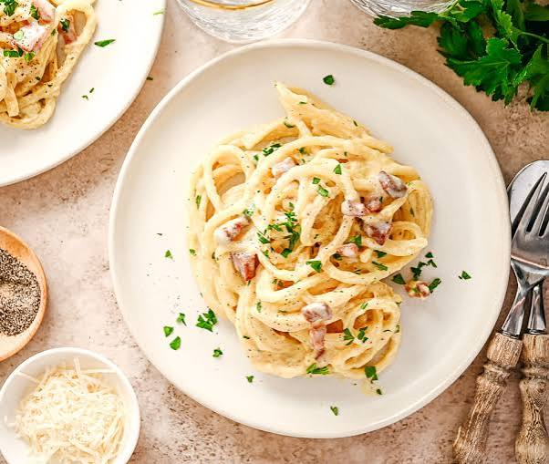

# skil_les05

# Carbonara

## BENODIGDHEDEN

- • 400 g spaghetti
- 200 g guanciale (varkenswang) of pancetta, in blokjes of reepjes
- 100 g Pecorino Romano of Parmezaanse kaas (geraspte kaas), plus extra om te garneren
- 3 eieren (of een combinatie van hele eieren en eidooiers)
- Zwarte peper (rijkelijk versgemalen)
- Zout

### BEREIDING

1. Pasta koken: Breng een grote pan met ruim water en een snuf zout aan de kook. Kook de spaghetti beetgaar (al dente) volgens de aanwijzingen op de verpakking. Vang een kopje van het kookvocht op voordat je de pasta afgiet.
2. Spek bakken: Bak de guanciale of pancetta in een grote koekenpan op middelhoog vuur tot het vet smelt en de spekjes knapperig zijn. Haal de pan van het vuur.
3. Eimengsel maken: Klop in een kom de eieren (of eidooiers) los samen met de geraspte kaas en een flinke hoeveelheid versgemalen zwarte peper.
4. Saus binden (van het vuur af!): Doe de warme, afgegoten spaghetti direct in de pan bij de spekjes en het bakvet. Giet het eier-kaasmengsel erbij en roer het geheel krachtig door. Voeg een scheutje van het warme kookvocht toe om een smeuïge, romige saus te creëren. Let op: zet de pan niet meer op het vuur, anders krijg je roerei.
5. Serveren: Verdeel de pasta over de borden en garneer met wat extra geraspte kaas en zwarte peper.
2. Tweede bereidingsstap.

[Bron van het recept](https://miljuschka.nl/spaghetti-carbonara/)